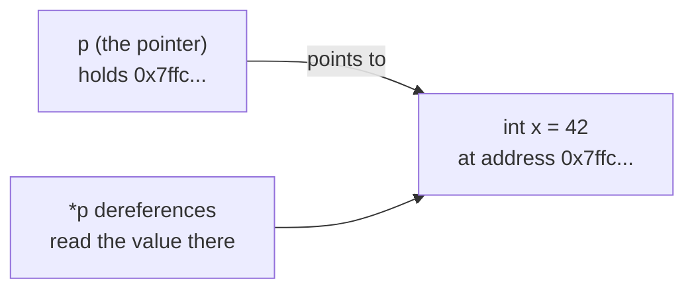
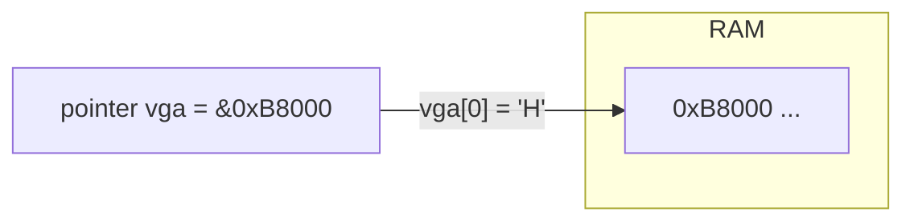
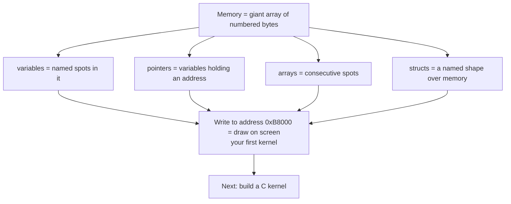

# Beginner C — Learn C Through Operating System Development

*Welcome! This tutorial assumes you have never written a line of C (or any code). It teaches the essentials of C the way OS developers actually use them — every concept points at something you'll touch the moment you build your first kernel.*

## Why learn C for OS development?

Operating systems are built in C. Linux, the Windows kernel, and most of the code between your programs and your hardware is C (or C++, its close relative). Why?

- **C has no safety net.** There is no garbage collector hiding memory from you — you manage memory by hand. That is exactly what an OS must do.
- **C talks to hardware directly.** C can write to any memory address, which is how a kernel controls the screen, the disk, and the CPU.
- **C is small.** A tiny C kernel compiles to a few kilobytes. C gives you *bare metal*.
- **Every other systems language** (Rust, C++, Go's low-level parts) borrows ideas from C. Learn C and the rest make sense.

An OS dev cares about one thing more than anything else: **memory**. So this tutorial's centerpiece is pointers and memory — the thing that separates C from every "safer" language, and the thing every kernel is built around.

---

## 1. Your first C program: `main`

Every C program starts in a function called `main`. When the OS runs your program, it calls `main`. When your *kernel* boots, the bootloader calls a C function too (we'll see it in the next chapter) — it just happens to be named `kernel_main` instead.

```c
// hello.c
int main(void) {
    return 0;
}
```

- `int` is the type of value `main` gives back ("0" means "all went well").
- `(void)` means "takes no arguments."
- The `{ }` braces wrap the function's *body* — the statements it runs.

Compile and run it:

```bash
gcc hello.c -o hello
./hello
```

> 🧠 **Kernel note:** In a *normal* program, the operating system calls `main`. In your *kernel*, there is no OS to call anything — so a bootloader reads a Multiboot header and jumps straight into your `kernel_main`. Same idea, one layer down.

---

## 2. Variables and their types

A variable is a named box in memory that holds a value of a certain type. C is *statically typed*: you say what type a variable is when you create it, and it stays that type.

```c
int main(void) {
    int    count   = 5;        // a whole number, 4 bytes
    char   letter  = 'A';      // one byte, usually ASCII text
    float  ratio   = 0.25f;    // a number with a decimal part, 4 bytes
    long   big     = 100000;   // a bigger whole number
    // ... use them ...
    return 0;
}
```

Each type takes a different *number of bytes* in memory:

| Type | Bytes | Holds |
|------|-------|-------|
| `char` | 1 | a single character / small number |
| `int` | 4 | a whole number |
| `long` | 4 or 8 | a larger whole number |
| `float` / `double` | 4 / 8 | numbers with fractions |

> 🧠 **Kernel note:** In a kernel you often care *exactly* how many bytes a type uses, because you're mapping memory. C lets you be explicit — e.g. `uint8_t` (1 byte), `uint32_t` (4 bytes) — which is how kernels describe hardware registers byte-for-byte.

**The OS lens:** every variable you create occupies real bytes in RAM. The OS (or your kernel) decides *where* those bytes live. That's the whole game — and it brings us to the single most important idea.

---

## 3. Memory addresses and pointers — the heart of C

Memory is a giant array of bytes, and *every byte has a number*: its **address**. When you declare a variable, the computer picks an address for it. You can ask for that address with `&`:

```c
int x = 42;
printf("x lives at address %p\n", (void*)&x);
```

A **pointer** is a variable that *stores an address* instead of a value. Declare a pointer with a `*`:

```c
int  x = 42;     // a normal int
int* p = &x;     // p holds x's address

printf("%d\n", *p);   // *p "dereferences" p: go to that address, read the value -> 42
```

- `int* p` reads as "p is a pointer to an int."
- `&x` gives the address of `x`.
- `*p` *follows* the pointer to the value at that address.



**Why this matters more than anything else in this tutorial:** an OS dev looks at memory addresses all day long. The **VGA text framebuffer** — the place your kernel writes text to the screen — is just an array of bytes sitting at a fixed address: `0xB8000`. Writing to the screen is literally "put a value at this address":

```c
/* The VGA text framebuffer starts at memory address 0xB8000. */
unsigned short* vga = (unsigned short*)0xB8000;

/* A VGA text cell = (color << 8) | character.
   0x0F = white-on-black, 'H' = the letter H. */
vga[0] = 0x0F00 | 'H';   // 0xB8000
vga[1] = 0x0F00 | 'i';   // 0xB8002
```

That's not a metaphor — that is *literally* how a real C kernel prints text. `vga` is a pointer, and you just used it to write to screen memory. This is the exact trick used in the [Hello World kernel chapter](../../synthesized_tutorials/01-c/README.md).



> 🧠 **Kernel note:** Writing `0x0F00 | 'H'` to `0xB8000` is called **memory-mapped I/O** — the hardware (the video card) appears at a regular memory address, so writing to memory *is* talking to hardware. No special instructions needed; just a pointer.

---

## 4. Functions: wrap the work up

A function is a named, reusable block of code. The C kernel keeps its logic in small functions — a VGA driver is a handful of them.

```c
/* returns the larger of two ints */
int max(int a, int b) {
    if (a > b) return a;
    return b;
}

/* a function that prints ONE character to the VGA screen */
static void vga_putchar(char c) {
    unsigned short* vga = (unsigned short*)0xB8000;
    /* position 0 is the screen's top-left corner */
    vga[0] = 0x0F00 | (unsigned char)c;
}
```

- `int max(int a, int b)` — the return type, name, then parameter types in parentheses.
- `void` return type means "returns nothing."
- `static` means "only visible inside this file" — kernels use it to hide internal helpers.

The **VGA driver** is just a few functions like this, bundled up. Real kernels are organized exactly this way: small functions, each doing one job.

---

## 5. Arrays: a run of values

An array is a *contiguous block* of values, all the same type, right next to each other in memory. Its name is a pointer to the first element.

```c
int scores[5];          // 5 ints, at 5 consecutive addresses
scores[0] = 90;         // set the first one
scores[1] = 85;

int sum = 0;
for (int i = 0; i < 5; i++) {
    sum += scores[i];
}
```

**The OS lens:** the VGA screen is a 2D grid of 80×25 cells, but to the computer it's a *1D array* of 2000 cells. Row-major indexing:

```c
#define VGA_WIDTH  80
#define VGA_HEIGHT 25
#define VGA_MEMORY ((unsigned short*)0xB8000)

unsigned int index = row * VGA_WIDTH + col;  // row 0..24, col 0..79
VGA_MEMORY[index] = 0x0F00 | (unsigned char)c;
```

A character at row 2, column 3 is just array element `2*80 + 3 = 163`. **A screen is an array; an array is just memory; memory is just addresses.** Once you think in those three equivalences, a kernel is no longer mysterious.

> 💡 **Danger:** C arrays do NOT check bounds. `scores[100]` won't crash your compile — it reads/writes whatever is 400 bytes past the array. In an OS this writing outside your array can corrupt another program's memory. Kernels are hair-trigger careful about exactly this.

---

## 6. Structs: group related data

A `struct` bundles several values into one unit. In an OS you use structs to describe *hardware*: a struct can lay out exactly the bytes of a device register, a disk partition, or a memory descriptor.

```c
/* one character on the VGA screen: color byte + ASCII byte */
struct vga_char {
    unsigned char character;
    unsigned char color;
};

/* each cell is one struct, 2 bytes, at a consecutive address */
struct vga_char* screen = (struct vga_char*)0xB8000;

screen[0].character = 'H';
screen[0].color     = 0x0F;   /* white on black */

struct vga_char* ps = &screen[0];   // pointer to a struct
ps->color = 0x1F;                   // -> is shorthand for (*ps).color
```

- `.` accesses a field through a struct value.
- `->` accesses a field through a *pointer* to a struct — used constantly in C.

> 🧠 **Kernel note:** This struct happens to be 2 bytes — exactly one VGA cell. Structs let you *paint a meaning over raw memory*, which is how OS code describes the interrupt descriptor table, page tables, and every hardware device. Structs + pointers + memory = most of OS development.

---

## 7. Summary: the mental model



- **main** is where a program (or `kernel_main`, where a kernel) starts.
- **Types** say how many bytes a value takes.
- **Pointers** hold addresses — the key that unlocks hardware.
- **Arrays** are consecutive memory; the VGA screen *is* an array at `0xB8000`.
- **Structs** shape raw bytes into meaningful hardware descriptions.

## Next steps: build a C kernel

You now know the C that matters. Time to make it real: head to the [Hello World kernel chapter](../../synthesized_tutorials/01-c/README.md) and write a 5 KB kernel that boots in QEMU and prints "Hello World!" to the VGA screen — using exactly the pointers, arrays, and structs you just learned.

Want the theory behind the boot process first? Read [How a computer boots](../../synthesized_tutorials/00-introduction/01-how-a-computer-boots.md) and [Bootloaders & Multiboot](../../synthesized_tutorials/concepts/01-bootloaders-and-multiboot.md), then come back.


---

## 🎬 Watch C in action

These are real, verified videos that complement the written tutorial. Click each to expand and watch inline:

<details class="video-embed"><summary>▶ Watch: CS50x — Memory (pointers, stack & heap)</summary>
<iframe src="https://www.youtube-nocookie.com/embed/F9-yqoS7b8w" width="100%" height="400" style="border:0;border-radius:8px;" allowfullscreen></iframe>
</details>
<details class="video-embed"><summary>▶ Watch: Pointers — CS50 Shorts</summary>
<iframe src="https://www.youtube-nocookie.com/embed/XISnO2YhnsY" width="100%" height="400" style="border:0;border-radius:8px;" allowfullscreen></iframe>
</details>
<details class="video-embed"><summary>▶ Watch: C Programming for Beginners (freeCodeCamp)</summary>
<iframe src="https://www.youtube-nocookie.com/embed/xND0t1pr3KY" width="100%" height="400" style="border:0;border-radius:8px;" allowfullscreen></iframe>
</details>
<details class="video-embed"><summary>▶ Watch: Pointers in C/C++ Full Course</summary>
<iframe src="https://www.youtube-nocookie.com/embed/zuegQmMdy8M" width="100%" height="400" style="border:0;border-radius:8px;" allowfullscreen></iframe>
</details>

---

## 🔗 Further resources (C)

- [C reference — cppreference.com/w/c](https://en.cppreference.com/w/c) — the authoritative reference for every C standard library function and keyword.
- [The GNU C Programming Tutorial](https://www.gnu.org/software/gnu-c-manual/gnu-c-manual.html) — the official GNU manual for C.
- [OSDev Wiki — Bare Bones (C)](https://wiki.osdev.org/Bare_Bones) — the canonical first C kernel tutorial, the same one this path is built around.
- [OSDev Wiki — Meaty Skeleton](https://wiki.osdev.org/Meaty_Skeleton) — the next step after Bare Bones: a proper kernel project structure.
- [C — Learn C with interactive lessons](https://learn-c.org/) — a free, hands-on C tutorial for complete beginners.
- [freeCodeCamp — C Programming course](https://www.youtube.com/watch?v=xND0t1pr3KY) — a full video course taking you through the whole language.
- [CS50x on edX](https://cs50.harvard.edu/x/) — Harvard's free intro course; Lecture 4 covers the memory model every OS dev needs.

