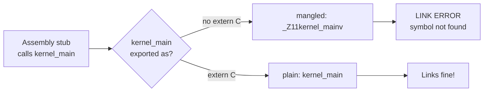
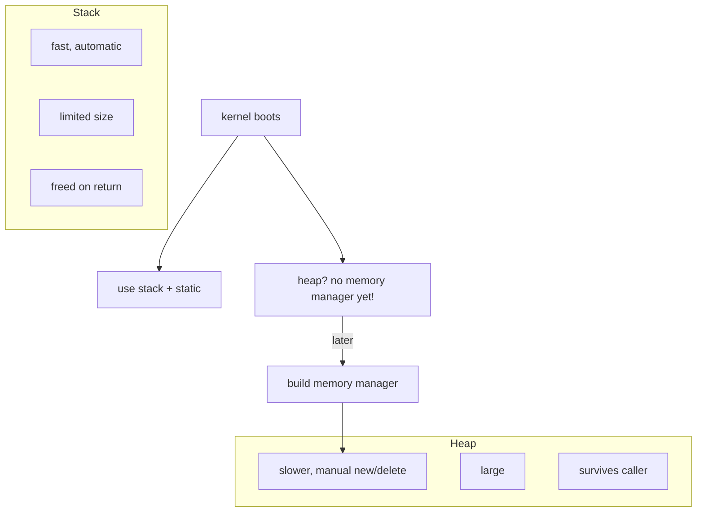

# Beginner C++ Tutorial (through the lens of OS development)

Welcome! This tutorial teaches you C++ from zero — but with a twist. Every concept is explained the way you will actually need it when you write your own operating-system kernel. By the end you will understand enough C++ to read and write a tiny kernel, and you will know *why* things like `extern "C"`, `-fno-exceptions`, and the stack-vs-heap distinction are so important in OS land.

If any background is fuzzy, first skim [how a computer boots](../../synthesized_tutorials/00-introduction/01-how-a-computer-boots.md) and [your toolchain](../../synthesized_tutorials/00-introduction/02-your-toolchain.md).

## Why C++ for an OS?

Most kernels are written in C (Linux, the BSDs) or increasingly Rust. So why C++?

- **As much control as C.** You can cast pointers, place structs at exact memory addresses, and talk directly to hardware — no garbage collector, no heavyweight runtime.
- **Better abstraction.** Classes, templates, and operator overloading let you organize a huge codebase without sacrificing speed.
- **Zero-cost abstractions.** With the right compiler flags, a `class` compiles to exactly the same machine code a hand-written `struct` would.

The catch: C++'s hidden machinery (exceptions, runtime type info, name mangling) is *hostile* to a bare-metal kernel unless you know how to turn it off. This tutorial teaches you exactly how.

## 1. Your first C++ program — objects

An object is just a region of memory that has *data* (member variables) and *behavior* (member functions). Here is the classic first step, written with an OS flavor:

```cpp
// hello.cpp
class Terminal {
public:
    // Constructor: runs automatically when the object is created.
    Terminal(unsigned int row, unsigned int col)
        : row_(row), col_(col) {}

    // A member function. In a real kernel, "print" would write
    // bytes straight into VGA memory (0xB8000).
    void print(const char* text) {
        // pretend this writes `text` to the framebuffer at (row_, col_)
    }

private:
    unsigned int row_;
    unsigned int col_;
};

// main could be the C++ entry point of a kernel, once a C function
// has set everything up. Notice the object is created on the stack.
int main() {
    Terminal term(0, 0);
    term.print("Hello from C++!");
    return 0;
}
```

`Terminal term(0, 0);` runs the constructor, which sets `row_` and `col_`. Nothing is allocated behind your back: this `term` lives on the stack, exactly like an `int`.

## 2. `extern "C"` and name mangling (crucial for kernels)

Here is a subtle thing that trips up every new OS developer. When the C++ compiler sees an overloaded function like:

```cpp
void timer_init();
void timer_init(int ms);
```

it cannot emit both as `timer_init` — the linker needs two distinct names. So it *mangles* them into names like `_Z9timer_initv` and `_Z9timer_initi`. That is fine *within* C++.

The problem: your kernel entry point is **not** called by C++ code. It is called by assembly, or by a bootloader, using plain C-style names. If you write:

```cpp
extern "C" void kernel_main();   // declared with C linkage
```

you are telling the compiler: *"Do not mangle this name. Export it exactly as `kernel_main`."* Your assembly stub can then link against a plain `kernel_main` symbol. Everything your kernel exposes to assembly (interrupt handlers, the entry point) must be `extern "C"`.



**Rule of thumb:** keep the kernel entry point and every *callable-from-assembly* function inside `extern "C"`. The rest of your C++ code can stay mangled and object-oriented.

## 3. References vs pointers

Your kernel will be full of both, so it is worth being precise.

- A **pointer** stores a memory address. It can be null, it can be reassigned, and it occupies its own storage (`sizeof(ptr) == 8` on 64-bit). `*ptr` dereferences it.
- A **reference** is an *alias* for an existing object. It is not null, it cannot be reassigned, and (in practice) it compiles to the same machine code as a pointer — it is just safer syntax.

```cpp
void write_pixel(unsigned char* framebuffer, int i, unsigned char v) {
    framebuffer[i] = v;      // pointer: must check it's valid yourself
}

void write_pixel2(unsigned char (&framebuffer)[], int i, unsigned char v) {
    framebuffer[i] = v;      // reference: can't be null, cleaner
}
```

Why prefer references when they are "just pointers underneath"? Because a reference documents intent: *"this argument must exist; I will not rebind it."* A pointer leaves open "it could be null" and "I might point it somewhere else." For OS APIs where you absolutely may receive a null pointer (hardware registers, optional memory-mapped regions), keep the pointer. When the value must be present, use a reference.

## 4. Stack vs heap — the memory that makes or breaks you

This distinction is *the* central fact of kernel memory management. Watch [The Cherno's Stack vs Heap in C++](https://www.youtube.com/watch?v=wJ1L2nSIV1s) and [his pointers video](https://www.youtube.com/watch?v=DTxHyVn0ODg) — then read on.

- **The stack** is a small, fast region that your code pushes onto and pops from automatically as functions call and return. Local variables live here. No cleanup needed — when a function returns, its locals are gone.
- **The heap** is a large pool the program draws from explicitly with `new` / `malloc` and must return with `delete` / `free`. It survives beyond the function that allocated it, but *you* are responsible for freeing it.

```cpp
class Page {
public:
    Page() : dirty_(false) {}
private:
    bool dirty_;
};

void demo() {
    Page p;             // stack: automatic, fast, freed on return.
    Page* q = new Page; // heap: survives demo(), must be deleted.
    // ... use q ...
    delete q;           // if you forget: memory leak.
}
```

For an OS this matters enormously:

- Your kernel has only one stack per CPU — the *kernel stack*. Keep stack usage shallow and predictable.
- Before your kernel has a working heap/memory manager, **any use of `new` will crash**, because `new` asks an allocator that does not exist yet. Early kernel code uses stack objects and static buffers *only*.
- Once you build a memory manager, you can enable heap allocation. Until then, avoid it.



## 5. Compiling a kernel: `-fno-exceptions -fno-rtti`

A normal C++ program may throw exceptions and use runtime type information (`dynamic_cast`, `typeid`). A kernel can do neither safely:

- **Exceptions** need a runtime to unwind the stack and unwind tables — a big, complex blob that must be present in every binary. On bare metal there is no runtime, so you compile with `-fno-exceptions`.
- **RTTI** (runtime type information) silently adds hidden per-class data. You compile with `-fno-rtti` to strip it out.

So a kernel is compiled (roughly) like this:

```bash
# The famous flags. Use them together.
g++ -ffreestanding -fno-exceptions -fno-rtti \
    -std=c++17 -O2 -Wall -Wextra -fno-pie -no-pie \
    -mno-red-zone -c kernel.cpp -o kernel.o
```

- `-ffreestanding` — "there is no standard library or OS here", so the compiler does not assume `printf`/`malloc` exist.
- `-fno-exceptions -fno-rtti` — strip the hidden machinery (as above).
- `-mno-red-zone` — x86-64 only: keep interrupts from clobbering stack you thought was free.

The exact set you need is spelled out in the [Bare Bones C++ reference](../../path_cpp_os/Bare_Bones_Cpp.md).

## 6. Why objects in C++? A tiny kernel-style struct

Here is a realistic glimpse: managing a physical frame (a unit of memory) as a C++ object, the way a real allocator would.

```cpp
extern "C" void kernel_main() {
    // early kernel: no heap yet, so build objects on the stack.
    Frame frame(0x100000);   // start of a conventional free region
    frame.mark_in_use();
    frame.print();
}

class Frame {
public:
    explicit Frame(unsigned long start) : start_(start), in_use_(false) {}
    void mark_in_use() { in_use_ = true; }
    void print() const {
        // write to VGA at 0xB8000... (see concepts/04-vga-text-mode.md)
    }
private:
    unsigned long start_;
    bool in_use_;
};
```

Notice the pattern: the *entry point* is `extern "C"`, but the object does real work. This is the C++ kernel idiom: a C/assembly shell around a C++ core.

## 7. Practice

1. Write the `Terminal` class from section 1. Change `main` to create two terminals on the stack and confirm they keep separate `row_`/`col_` state.
2. Add a second overload of a function and observe what the compiler *actually* names them — compile with `-c` and inspect with `nm kernel.o` or `objdump`. Watch the mangled names appear, then rebuild with `extern "C"` and see them become plain.
3. Write a function that takes both a `Page&` reference and a `Page*` pointer; call both from `main`. Confirm the reference version cannot be given null.
4. Re-read the compiler flags in section 5. Explain in one sentence each why `-fno-exceptions` and `-fno-rtti` exist.

## Next steps: build a C++ kernel

You now know the three things that make C++ work on bare metal — `extern "C"`, stack-first memory, and the freestanding compiler flags. The next lesson takes all of it and produces a real, bootable kernel that prints to the screen:

👉 **Continue to: [C++ Hello-World kernel](../../synthesized_tutorials/03-cpp/README.md)**

After that, learn the concepts your kernel will touch: [bootloaders](../../synthesized_tutorials/concepts/01-bootloaders-and-multiboot.md), [memory management](../../synthesized_tutorials/concepts/02-memory-management.md), and [VGA text mode](../../synthesized_tutorials/concepts/04-vga-text-mode.md) — and the full [Bare Bones C++ reference](../../path_cpp_os/Bare_Bones_Cpp.md).

## Great C++ videos to pair with this tutorial

All verified and beginner-friendly:

- [The Cherno — Complete C++ playlist](https://www.youtube.com/playlist?list=PLlrATfBNZ98dudnM48yfGUldqGD0S4FFb)
- [How C++ Works](https://www.youtube.com/watch?v=SfGuIVzE_Os) — compilers, linkers, and why `extern "C"` exists.
- [POINTERS in C++](https://www.youtube.com/watch?v=DTxHyVn0ODg)
- [Stack vs Heap Memory in C++](https://www.youtube.com/watch?v=wJ1L2nSIV1s)
- [REFERENCES in C++](https://www.youtube.com/watch?v=IzoFn3dfsPA)
- [CLASSES in C++](https://www.youtube.com/watch?v=2BP8NhxjrO0)


---

## 🎬 Watch C++ in action

These are real, verified videos from The Cherno's series, paired with the sections above. Click each to expand and watch inline:

<details class="video-embed"><summary>▶ Watch: How C++ Works — compilers & linkers (The Cherno)</summary>
<iframe src="https://www.youtube-nocookie.com/embed/SfGuIVzE_Os" width="100%" height="400" style="border:0;border-radius:8px;" allowfullscreen></iframe>
</details>
<details class="video-embed"><summary>▶ Watch: Pointers in C++ (The Cherno)</summary>
<iframe src="https://www.youtube-nocookie.com/embed/DTxHyVn0ODg" width="100%" height="400" style="border:0;border-radius:8px;" allowfullscreen></iframe>
</details>
<details class="video-embed"><summary>▶ Watch: Stack vs Heap Memory in C++ (The Cherno)</summary>
<iframe src="https://www.youtube-nocookie.com/embed/wJ1L2nSIV1s" width="100%" height="400" style="border:0;border-radius:8px;" allowfullscreen></iframe>
</details>
<details class="video-embed"><summary>▶ Watch: Classes in C++ (The Cherno)</summary>
<iframe src="https://www.youtube-nocookie.com/embed/2BP8NhxjrO0" width="100%" height="400" style="border:0;border-radius:8px;" allowfullscreen></iframe>
</details>

---

## 🔗 Further resources (C++)

- [C++ reference — cppreference.com](https://en.cppreference.com/w/) — the definitive reference for the C++ standard library and language.
- [LearnCpp.com](https://www.learncpp.com/) — a free, thorough, beginner-to-advanced online C++ tutorial.
- [The Cherno — C++ playlist](https://www.youtube.com/playlist?list=PLlrATfBNZ98dudnM48yfGUldqGD0S4FFb) — the video series this path recommends, in order.
- [isocpp.org](https://isocpp.org/) — the official home of the C++ standard, FAQs, and community resources.
- [OSDev Wiki — C++ Bare Bones](https://wiki.osdev.org/C%2B%2B_Bare_Bones) — the canonical C++ kernel tutorial, with the exact freestanding compiler flags.
- [cppreference — C++ language](https://en.cppreference.com/w/cpp/language) — the language grammar, objects, and memory model in one place.

