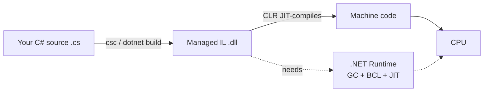

# Beginner C# Tutorial (through the lens of OS development)

This is **original content** written for OSDev_Learning_Hub. It teaches you
C# from zero — classes, types, collections, async — and then delivers the
one insight that matters for this site:

> **C# does not compile to machine code. It compiles to managed IL that
> needs a runtime — which is why writing an OS in C# means using a
> framework like Cosmos.**

Read it straight through if you're new. If you already know C#, skim to
**Part 2** below, where the OS-dev lesson lives.

---

## Part 1 — C# for beginners

### 1.1 Types: the building blocks

C# is a strongly typed, object-oriented language. Every value has a type,
and the compiler checks that you use it correctly. Like C, you have
value types; but like the managed runtimes, you also get reference types
managed automatically.

```csharp
// Value types live on the stack (or inline), like C's ints.
int cores   = 4;
long memory = 8L * 1024 * 1024 * 1024; // 8 GiB, as bytes
bool isKernel = true;
char letter   = 'A';

// Reference types live on the "managed heap". You never free them —
// the garbage collector does.
string name = "Cosmos";
object anything = 42; // boxing wraps a value type in a managed object
```

The `var` keyword lets the compiler infer the type. It's idiomatic C#:

```csharp
var greeting = "Hello from C#"; // var is string
var cores     = 4;              // var is int
```

### 1.2 Classes: the heart of C#

Everything you bundle together is a **class**. A class groups data (fields
and properties) with behavior (methods). This is the OOP model we saw in
C++, but in C# almost everything you touch is an object.

```csharp
public class Process
{
    // A property: a field with get/set accessors.
    public string Name { get; set; }
    public int    Pid  { get; private set; }

    // A constructor: runs when you `new` the object.
    public Process(string name)
    {
        Name = name;
        Pid  = Environment.ProcessId;
    }

    // A method.
    public void Describe() => Console.WriteLine($"PID {Pid}: {Name}");
}

// Usage
var proc = new Process("init");
proc.Describe(); // "PID 1234: init"
```

Notice the `$"..."` **string interpolation** — a C# nicety that avoids
clumsy `+` concatenation. Good for readable kernel logging.

### 1.3 Collections: lists, dictionaries, arrays

Real programs (and OSes) store many things. C# gives you generic collections
straight out of the box.

```csharp
using System.Collections.Generic;

var drivers = new List<string> { "keyboard", "mouse", "vga" };
drivers.Add("disk");
Console.WriteLine(drivers.Count); // 4

var portMap = new Dictionary<int, string>
{
    { 0x60, "keyboard" },
    { 0x3D4, "vga index" }
};
Console.WriteLine(portMap[0x60]); // "keyboard"

int[] memoryLayout = { 0xB8000, 0x100000, 0xFFFFF }; // array
```

`List<T>`, `Dictionary<K,V>` and arrays are the workhorses. They're generic,
so they're type-safe: a `List<string>` can never accidentally hold an `int`.

### 1.4 Control flow

Borrowing from C syntax, C# has `if`/`else`, `for`, `foreach`, `while`, and
`switch`. `foreach` is the idiomatic way to walk a collection:

```csharp
foreach (string d in drivers)
{
    if (d == "vga")
        Console.WriteLine("Found the framebuffer driver!");
}
```

A `switch` can even match on a string or match *patterns*:

```csharp
switch (command)
{
    case "help":   Console.WriteLine("Commands: help, clear, hello"); break;
    case "clear":  Console.Clear(); break;
    case "hello":  Console.WriteLine("Hello from your OS!"); break;
    default:       Console.WriteLine($"Unknown command: {command}"); break;
}
```

### 1.5 `async` / `await`: asynchrony without threads

Modern C# handles long-running work with `async`/`await` instead of manual
thread creation. `await` yields control so the caller isn't blocked, and
resumes when the work completes.

```csharp
using System.Net.Http;

static async Task<string> FetchAsync(string url)
{
    using var client = new HttpClient();
    return await client.GetStringAsync(url); // awaits, doesn't block
}

// Usage
string html = await FetchAsync("https://example.com");
Console.WriteLine(html.Length);
```

`await` *pauses* the method, returns control to its caller, and continues
when the awaited `Task` finishes. It's cooperative, not preemptive — useful
conceptually because an OS scheduler does something similar at a lower level.

> ⚠️ **OS-dev note:** `async`/`await` runs on the .NET *task scheduler*,
> which needs a runtime. Your Cosmos kernel's `Run()` loop, by contrast, is
> a tight synchronous `while (true)` — because on bare metal *you* are the
> scheduler.

---

## Part 2 — The KEY insight: C# needs a runtime

You now know enough C# to write real programs. But this site is about
operating systems — and here is where C# and OS development collide.

### 2.1 Where your code actually runs

When you compile a C program, you get **native machine code** — bytes your
CPU executes directly. When you compile C#, you get **managed IL**
(Intermediate Language): a cross-platform bytecode. IL is *not* executed by
the CPU. It's executed by a **runtime** — the Common Language Runtime (CLR) —
that JIT-compiles it on the fly and manages your memory.



That runtime is a huge, sophisticated program in its own right. It provides:

- **The garbage collector (GC)** — the automatic memory manager.
- **The base class library (BCL)** — thousands of classes (`string`,
  `List`, file I/O, networking...).
- **The JIT compiler** — turns IL into native code at run time.

### 2.2 Managed vs. unmanaged memory: the honest story

| | C / C++ (unmanaged) | C# (managed) |
|---|---|---|
| Who allocates? | you (`malloc`/`new`) | the runtime (`new`) |
| Who frees? | **you** (`free`/`delete`) | the **garbage collector** |
| Leak if you forget? | yes | rare (GC reclaims) |
| Dangling pointer? | possible, dangerous | essentially impossible (no raw pointers) |
| Pointer arithmetic | yes, fully | only inside `unsafe` blocks |

The GC traces reachable objects from *roots* (the stack and static fields).
Anything unreachable is garbage and gets collected — no explicit free. That
is a real safety win for application code. But it means **memory is owned by
the runtime**, and the runtime assumes the machine is already running an OS
that gave it memory.

### 2.3 Why that breaks bare metal

An OS kernel is the *first* thing on the machine. There is no OS underneath
to hand the CLR memory, set up thread stacks, or provide the syscalls the
BCL calls. When C/C++/Rust/Go kernels boot, their `_start` entry point simply
begins executing native code — no runtime needed (Go and C++ make you stub
out a minimal runtime, as you'll see in those paths).

C# is the **end of that road**. Its runtime is not an optional feature you
can disable, like C++ exceptions. The *entire execution model* — GC, JIT,
BCL, `async` scheduler — depends on underlying OS services. To run C# on
bare metal you must **bring the runtime with you**, ahead-of-time, as part
of the kernel.

```mermaid
flowchart TD
    subgraph "C / Rust / Go on bare metal"
        A1[boot.s -> _start] --> A2[native machine code]
        A2 --> A3[poke 0xB8000 directly]
    end
    subgraph "C# on bare metal"
        B1[Kernel.cs] --> B2[managed IL]
        B2 --> B3[needs .NET runtime]
        B3 --> B4[? no OS underneath]
    end
    subgraph "C# + Cosmos"
        C1[Kernel.cs : Cosmos.System.Kernel]
        C1 --> C2[Cosmos IL2CPU / NativeAOT]
        C2 --> C3[compiles IL to native, bootable ISO]
        C3 --> C4[Console.WriteLine -> real VGA]
    end
```



### 2.4 The fix: a framework (Cosmos)

Because bootstrapping the whole .NET runtime by hand is a massive
engineering project, the realistic beginner path is to **let a framework do
it**. The **Cosmos** OS kit (C# Open Source Managed Operating System) is
exactly that: an "OS construction kit" that

- compiles your C# **ahead of time** to native machine code via **IL2CPU**
  (its original IL-to-x86 compiler) or **NativeAOT** (.NET's own AOT
  compiler),
- packs in a small runtime with its own GC, a scheduler, drivers and
  filesystem,
- produces a **bootable ISO** you load in QEMU or VMware.

You write ordinary C# — subclasses of `Cosmos.System.Kernel`, overriding
`BeforeRun()` and `Run()` — and Cosmos turns it into a real OS.

```csharp
public class Kernel : Cosmos.System.Kernel
{
    protected override void BeforeRun() => Console.WriteLine("Booting...");

    protected override void Run()
    {
        Console.WriteLine("Hello from my own C# OS!");
        while (true)
        {
            Console.Write("> ");
            string input = Console.ReadLine()!;
            Console.WriteLine($"You typed: {input}");
        }
    }
}
```

You never touch `0xB8000` — Cosmos routes `Console` to the real video
hardware for you. That's the comfort *and* the trade-off: the raw-hardware
lesson you got in C/Rust/Go is handed to the framework. So when you *must*
control hardware bit-by-bit, reach for C; when you just want a working OS
quickly, C# + Cosmos wins.

---

## Part 3 — What you learned

1. C# is **strongly typed and object-oriented**: classes, properties,
   constructors, string interpolation.
2. **Collections** (`List<T>`, `Dictionary<K,V>`, arrays) are type-safe and
   built in.
3. `async`/`await` gives cooperative asynchrony **on a runtime scheduler** —
   something a bare-metal kernel must build itself.
4. C# compiles to **managed IL**, not native code, and needs a runtime with
   a **garbage collector** — a *managed* memory model where memory is owned
   by the runtime, not by you.
5. On bare metal there is no OS to host that runtime, so **C# needs a
   framework** — Cosmos, via **IL2CPU / NativeAOT** — to compile your C# to
   a bootable OS.

---

## Next steps: build a C# OS with Cosmos

Now put it together. Read how the edge case really works and follow the
build steps: **[Building "Hello World!" in C# (and why it's an edge case)](../../synthesized_tutorials/05-csharp/README.md)**

From there, grab the full boilerplate and toolchain in the
[**Example OS project (C#)**](../../Example_OS_Project/csharp-README.md) and
[**setup guide**](../../Example_OS_Project/docs/setup.md), then boot your own
C# operating system in QEMU.


---

## 🎬 Watch C# in action

These are real, verified videos that complement the tutorial above. Click each to expand and watch inline:

<details class="video-embed"><summary>▶ Watch: C# Tutorial — Full Course for Beginners (freeCodeCamp)</summary>
<iframe src="https://www.youtube-nocookie.com/embed/GhQdlIFylQ8" width="100%" height="400" style="border:0;border-radius:8px;" allowfullscreen></iframe>
</details>
<details class="video-embed"><summary>▶ Watch: Garbage Collector in .NET Explained (the managed memory model)</summary>
<iframe src="https://www.youtube-nocookie.com/embed/QvO5Htgb5-Y" width="100%" height="400" style="border:0;border-radius:8px;" allowfullscreen></iframe>
</details>
<details class="video-embed"><summary>▶ Watch: The Operating System Construction Kit: Cosmos! (Cosmos Quest #1)</summary>
<iframe src="https://www.youtube-nocookie.com/embed/Khff1xxyEHI" width="100%" height="400" style="border:0;border-radius:8px;" allowfullscreen></iframe>
</details>
<details class="video-embed"><summary>▶ Watch: Make a Simple OS using C# and COSMOS</summary>
<iframe src="https://www.youtube-nocookie.com/embed/WSsZh3dVtaI" width="100%" height="400" style="border:0;border-radius:8px;" allowfullscreen></iframe>
</details>

---

## 🔗 Further resources (C#)

- [Microsoft Learn — C# documentation](https://learn.microsoft.com/en-us/dotnet/csharp/) — the official reference, tutorials, and language spec.
- [Tour of C#](https://learn.microsoft.com/en-us/dotnet/csharp/tour-of-csharp/) — a quick guided overview for new C# programmers.
- [Cosmos OS](https://www.gocosmos.org/) — the C# open-source operating system construction kit this path recommends.
- [Cosmos on GitHub](https://github.com/CosmosOS/Cosmos) — the source code behind the Cosmos framework.
- [OSDev Wiki — C Sharp Bare Bones](https://wiki.osdev.org/C_Sharp_Bare_Bones) — the OSDev community tutorial for C# kernels.
- [The Managed Common Intermediate Language (CIL) spec — ECMA-335](https://www.ecma-international.org/publications-and-standards/standards/ecma-335/) — the standard behind managed IL, the core of the C# edge case.

