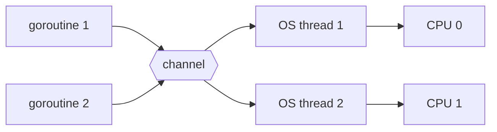
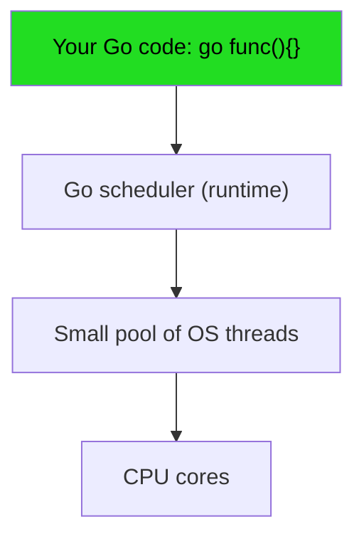
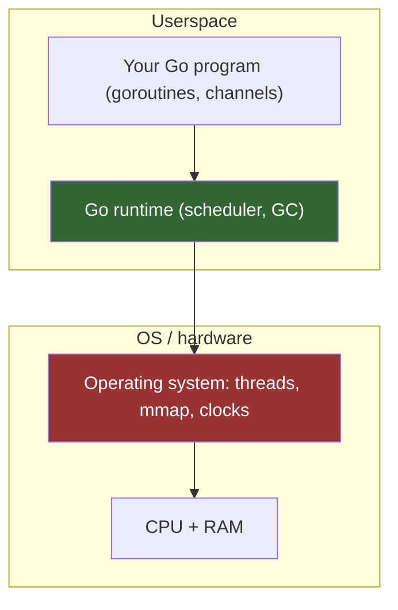

# Beginner Go Tutorial

Welcome. This is a *beginner* tutorial to the Go programming language, taught through
the lens of OS development. You do not need any prior Go experience, and you only need a
little programming background. By the end you will be able to read and write credible
Go, and you will understand why Go is both tempting and frustrating as a kernel
language.

> **A note on honesty** — Go was not designed for hand-rolled bare-metal code. Its
> garbage collector and runtime assume an operating system and virtual memory exist
> underneath. This tutorial teaches real Go *and* tells you the truth about what happens
> when you try to use it without an OS. That honesty is part of the point.

---

## 1. Why Go, and why Go for OS dev?

Go (often called *Golang*) is a compiled, statically typed language created at Google in
2009. Its selling points:

- **Simple and readable** — a small language with very few clever features to memorize.
- **Fast builds** — compiling even large codebases takes seconds, not minutes.
- **Easy concurrency** — goroutines and channels make parallel code dramatically simpler
  than in C or C++.
- **Automatic memory management** — a garbage collector frees you from manual
  `malloc`/`free`.

For OS development, the *concurrency* is the main lure. An OS is all about many things
happening at once: interrupts firing, processes switching, devices being serviced. In C
you juggle threads, locks, and callbacks. In Go, you say `go someFunction()` and the
runtime worries about the rest.

That lure is also the trap. The concurrency you love is provided by a runtime that
needs an OS to exist. More on that in section 5.

## 2. Packages: how Go code is organized

A Go program is built from **packages** — folders of `.go` files that are compiled
together. Every `.go` file starts with a `package` clause, and a program's entry point
is `package main` with a `main` function.

```go
package main

import "fmt"

func main() {
    fmt.Println("Hello, OS world!")
}
```

Run it from a terminal:

```sh
go run hello.go
```

**Package rules that matter for a systems person:**

- `main` is special — it defines an executable.
- Anything imported but unused is a **compile error**. Go is strict; it keeps builds
  clean and fast.
- Whole packages get *lowercase* names by convention (like `fmt`, `os`, `net`).

Think of a package as a "module" containing related functions. When you write a kernel,
you might split it into a `render` package (VGA output), a `mem` package (allocator), and
so on.

## 3. Slices and structs: the data you care about

### Slices

A **slice** is Go's dynamic array — a window over a contiguous block of memory. In the
kernel world, think of it as the closest thing to a C array with a length attached, but
safer.

```go
// A slice of two bytes, like a tiny framebuffer row.
row := []byte{0, 0, 255} // blue pixel
row[2] = 0               // set blue to 0

// Appending grows the slice (with a possible copy underneath).
row = append(row, 0, 255, 0)
```

A slice has three parts under the hood: a **pointer** to the backing array, a
**length**, and a **capacity**. Slicing shares the underlying memory:

```go
frame := make([]byte, 80*25) // 80x25 VGA text buffer
firstLine := frame[:80]      // no copy — same memory!
```

That "no copy" behaviour is powerful for a kernel writer, but also a classic source of
bugs: two slices can alias the same memory, and writing to one writes to the other.

### Structs

A **struct** groups related values into one type — exactly how you would describe a
register or a descriptor entry.

```go
// A 16-bit VGA color: 4 bits foreground, 4 bits background.
type Color struct {
    Foreground uint8
    Background uint8
}

func main() {
    c := Color{Foreground: 7, Background: 0} // light gray on black
    fmt.Printf("fg=%d bg=%d\n", c.Foreground, c.Background)
}
```

You can attach **methods** to a struct:

```go
func (c Color) byte() uint8 {
    return c.Foreground | (c.Background << 4)
}
```

Methods make structs feel like small objects without the ceremony of full
object-oriented programming.

## 4. Goroutines and channels: Go's concurrency superpower

This is the part that makes OS developers fall in love. A **goroutine** is a
lightweight, concurrent function call — you launch it with the `go` keyword:

```go
package main

import (
    "fmt"
    "time"
)

func printLoop(msg string) {
    for i := 0; i < 5; i++ {
        fmt.Println(msg, i)
        time.Sleep(10 * time.Millisecond)
    }
}

func main() {
    go printLoop("first")  // runs concurrently
    go printLoop("second") // and this one too
    time.Sleep(100 * time.Millisecond)
    fmt.Println("main done")
}
```

Thousands of goroutines cost far less than thousands of OS threads because the Go
runtime multiplexes them onto a smaller pool of real threads (its famous *M:N
scheduler*).

**Channels** are how goroutines safely talk to each other — a typed pipe with `<-` for
send and receive:

```go
func worker(id int, jobs <-chan int, done chan<- bool) {
    for j := range jobs {
        fmt.Println("worker", id, "handled job", j)
    }
    done <- true
}

func main() {
    jobs := make(chan int)
    done := make(chan bool)

    go worker(1, jobs, done)

    for j := 0; j < 10; j++ {
        jobs <- j // hand a job to the worker
    }
    close(jobs)

    <-done // wait until the worker is finished
}
```

The rule that keeps this safe is one of Go's most famous sayings:

> **"Do not communicate by sharing memory; instead, share memory by communicating."**

Channels carry copies of data between goroutines; two goroutines never touch the same
buffer directly unless you deliberately share it (e.g. by passing a slice or pointer —
which is exactly what kernels do, carefully, under locks).

Here is the mental model of what the runtime is doing for you:





## 5. Why Go's GC and runtime make bare-metal hard

Here is the honest part. Everything beautiful above is delivered by a running **Go
runtime** that sits between your code and the hardware. That runtime assumes:

1. **An OS provides memory.** Your goroutine stacks and heap allocations come from
   `mmap`/`sbrk`. On bare metal there is no OS to call — someone (you) must write an
   allocator the runtime can use.
2. **A garbage collector manages your memory.** The GC scans and moves memory
   automatically. In a kernel, memory is a scarce, precious resource, and you usually
   cannot afford a collector pausing the machine.
3. **Threads exist to run goroutines on.** The scheduler needs a kernel to provide
   threads and a clock. On bare metal you must bootstrap that yourself.
4. **The standard library is huge.** Packages like `fmt`, `net`, and `os` all talk to an
   OS underneath. None of that exists on bare metal.

The classic solution is **gccgo** — a Go compiler backend for GCC that can produce
freestanding (no-OS) binaries. But even then, Go needs stubs: tiny functions the
compiler emits calls to (for GC bookkeeping, memory allocation, and goroutine setup)
that *you* must provide. Getting a Go kernel to print a single character typically
involves writing or stubbing a surprising amount of plumbing.

What OS dev *keeps* you honest about:

| Feature you love | What you give up on bare metal |
|------------------|--------------------------------|
| Goroutines       | The scheduler that runs them    |
| Garbage collector| Automatic memory hygiene        |
| Standard library | Everything that needs an OS     |
| Easy builds      | A bootable binary that with calls into userspace helpers |

A concrete mental model of the runtime's dependency on the OS:



The red box is the layer that a bare-metal Go kernel must replace or stub.

## 6. Try it yourself

If Go is installed, run these small exercises — each is a stepping stone to a kernel:

```sh
# 1. Your first program
cat > hello.go <<'EOF'
package main
import "fmt"
func main() { fmt.Println("hello kernel") }
EOF
go run hello.go

# 2. A slice-based "framebuffer"
cat > fb.go <<'EOF'
package main
import "fmt"
func main() {
    fb := make([]byte, 80*25)
    for i := range fb { fb[i] = ' ' }
    fb[0] = 'H'
    fmt.Printf("row0 col0 = %q\n", fb[0])
}
EOF
go run fb.go
```

Don't be discouraged if the "hello kernel" output just appears in your terminal — on
your real OS, that *is* the OS doing the printing for you. The whole game of OS dev is
getting to the point where *your* kernel does that printing instead.

## Next steps: build a Go kernel

You now know enough Go to read (and mostly understand) the real, non-trivial work of
getting Go onto the bare metal. The next chapter walks you through the toolchain, the
compiler flags, and the stubs you need to turn Go into a bootable binary.

**[Continue to the Go Hello-World kernel chapter →](../../synthesized_tutorials/04-go/README.md)**

If you want to keep your Go language skills sharp while staying systems-oriented, the
video talks on the [path landing page](index.md) (scheduler internals, escape analysis,
stack vs. heap) are an excellent companion.


---

## 🎬 Watch Go in action

These are real, verified GopherCon talks that complement the concepts above. Click each to expand and watch inline:

<details class="video-embed"><summary>▶ Watch: GopherCon 2018: The Scheduler Saga (how goroutines map to threads)</summary>
<iframe src="https://www.youtube-nocookie.com/embed/YHRO5WQGh0k" width="100%" height="400" style="border:0;border-radius:8px;" allowfullscreen></iframe>
</details>
<details class="video-embed"><summary>▶ Watch: GopherCon 2017: Understanding Channels</summary>
<iframe src="https://www.youtube-nocookie.com/embed/KBZlN0izeiY" width="100%" height="400" style="border:0;border-radius:8px;" allowfullscreen></iframe>
</details>
<details class="video-embed"><summary>▶ Watch: Understanding Allocations: the Stack and the Heap</summary>
<iframe src="https://www.youtube-nocookie.com/embed/ZMZpH4yT7M0" width="100%" height="400" style="border:0;border-radius:8px;" allowfullscreen></iframe>
</details>

---

## 🔗 Further resources (Go)

- [The Go Tour](https://go.dev/tour/) — the official interactive introduction to Go, from zero.
- [Go Documentation](https://go.dev/doc/) — effective Go, the language spec, and how to install the toolchain.
- [The Go Blog](https://go.dev/blog/) — official deep-dives including the scheduler, memory, and concurrency.
- [OSDev Wiki — Go Bare Bones](https://wiki.osdev.org/Go_Bare_Bones) — the canonical kernel tutorial that this path's reference is based on.
- [The Go Memory Model](https://go.dev/ref/mem) — the language's formal memory model, relevant to what Go's runtime promises.
- [Effective Go](https://go.dev/doc/effective_go) — the standard, idiomatic style guide every Go developer should read.

