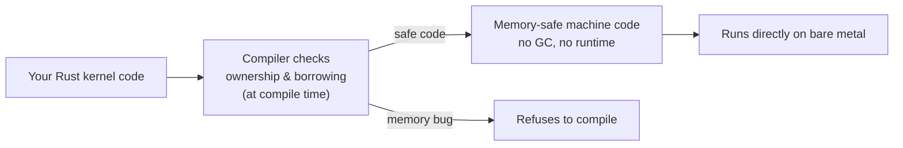

# Beginner Rust Tutorial — for OS Development

Welcome. This tutorial teaches you **just enough Rust to build a kernel**. It's
not a general-purpose "learn every Rust feature" course; instead, every concept
is taught *through the lens of writing an operating system*. When you're done,
you'll be able to read the [Rust Hello-World kernel
chapter](../../synthesized_tutorials/02-rust/README.md) and understand every
line.

---

## Why Rust for OS development?

An OS kernel is the first program that runs on the machine. It manages memory,
drives hardware, and never crashes gracefully — a kernel bug is a full system
crash. For decades that meant writing kernels in C, where a single mistake
(a buffer overflow, a use-after-free, a dangling pointer) corrupts memory in
ways that are brutally hard to debug.

Rust solves this at a fundamental level. The language's central idea is
**memory safety without a garbage collector**: the compiler *proves* your code
cannot have these bugs, *before* the program ever runs. No runtime, no GC, no
hidden cost. This is exactly what an OS needs.



---

## Your first Rust program

If you haven't already, install Rust with `rustup` (see [Your
toolchain](../../synthesized_tutorials/00-introduction/02-your-toolchain.md)),
then create a new project:

```
cargo new --bin hello_os
cd hello_os
cargo run
```

You'll see `Hello, world!`. Now edit `src/main.rs`:

```rust
fn main() {
    let greeting = "Hello from Rust";
    println!("{}", greeting);
}
```

This looks ordinary, but there's something important hiding in it: `println!`
and `String`-based formatting depend on the **standard library**, which itself
depends on an existing **operating system**. A kernel can't use that — and
that's the whole point of this path.

---

## Ownership: memory safety without a garbage collector

Every value in Rust has exactly **one owner** at any time. When the owner goes
out of scope, the value is freed automatically (this is called *drop*). There
is no `free()` to forget and no GC to run.

The rules:

1. Each value has one owner.
2. There is only one owner at a time — ownership can *move*.
3. When the owner goes out of scope, the value is dropped.

```rust
fn main() {
    let s1 = String::from("kernel");
    let s2 = s1;              // ownership MOVES from s1 to s2
    println!("{}", s2);       // ok
    // println!("{}", s1);    // ERROR: s1 was moved, no longer valid
}
```

The moment you try to use `s1` after the move, the compiler stops you. That
compile-time error **is** the memory-safety guarantee: you can never have two
owners accidentally double-free the same memory.

## Borrowing: use a value without owning it

Moving values around constantly is annoying. Instead, you can **borrow** —
take a reference without taking ownership. Rust has two kinds of references,
and the borrow checker enforces one rule over both:

> **Either** many shared (`&`) read-only references, **or** one exclusive
> (`&mut`) mutable reference at a time — never both.

```rust
fn print_len(s: &str) {            // borrows, doesn't own
    println!("len = {}", s.len());
}

fn main() {
    let msg = String::from("Hello OS");
    print_len(&msg);               // pass a reference
    print_len(&msg);               // can borrow again — msg still valid
}
```

This one rule eliminates whole classes of bugs (data races, iterator
invalidation, use-after-free) at compile time. Understanding the borrow
checker is the single hardest — and single most valuable — part of learning
Rust.

---

## `no_std`: refusing the standard library

Now the OS twist. The standard library depends on OS services. A kernel must
run with **no underlying OS**, so we remove the standard library entirely:

```rust
#![no_std]      // do NOT link the Rust standard library
```

With `no_std`, you lose `println!`, `String`, `Vec`, files, threads. What you
keep is the core language: ownership, borrowing, pattern matching, enums,
generics, closures, `Option`/`Result`. These work on bare metal, and they're
more than enough to write a kernel.

```mermaid
flowchart TD
    A[#![no_std]] --> B["No standard library linked"]
    B --> C["No #[std::prelude]...<br/>primitives still available"]
    B --> D["No OS services: no files,<br/>no heap (yet), no threads"]
    C --> E["Ownership, borrowing,<br/>enums, Option/Result all work"]
```

## `no_main`: the entry point problem

A normal Rust program has a `main()` function that the runtime calls. But a
kernel has no runtime — the **bootloader** grabs control of the CPU instead.
So we tell Rust not to use its normal startup:

```rust
#![no_std]
#![no_main]

#[no_mangle]
pub extern "C" fn _start() -> ! {
    // the bootloader jumps here — this is our kernel entry point
    loop {}
}
```

- `#![no_main]` — don't expect the normal `main` runtime.
- `#[no_mangle] pub extern "C" fn _start` — a C-linkage function named
  `_start`, exactly what the bootloader looks for.
- `-> !` — the *never* type: `_start` never returns, so it loops forever.

## The panic handler

If something goes wrong in your kernel, there's no standard library to print a
nice error and unwind. You must provide your own handler for panics:

```rust
#[panic_handler]
fn panic(_info: &core::panic::PanicInfo) -> ! {
    loop {}
}
```

This is what runs when a `panic!` happens — in our minimal kernel it just halts.
The OS-level lesson: on bare metal, *you* define what happens on fatal errors.

---

## A freestanding binary

Putting it together, a minimal freestanding kernel that compiles to bare metal
looks like this. Make a new `cargo new --bin kernel`, write this to
`src/main.rs`, and add a `rust-toolchain.toml` with `nightly` set:

```rust
#![no_std]          // no standard library — we are the OS
#![no_main]         // no normal main() runtime

use core::panic::PanicInfo;

// The bootloader jumps here first.
#[no_mangle]
pub extern "C" fn _start() -> ! {
    // 0xB8000 is the start of VGA text-mode video memory.
    // Writing here is inherently unsafe — we're poking raw memory.
    let vga = 0xb8000 as *mut u8;
    let text = b"Hello Kernel!";

    unsafe {
        for (i, &byte) in text.iter().enumerate() {
            vga.add(i * 2).write_byte(byte); // character
            vga.add(i * 2 + 1).write_byte(0x0F); // color: white on black
        }
    }

    loop {}
}

#[panic_handler]
fn panic(_info: &PanicInfo) -> ! {
    loop {}
}
```

Let's dissect the interesting parts:

- **`0xB8000`** — the memory-mapped VGA text buffer. Writing bytes here makes
  the screen show characters (see [VGA text
  mode](../../synthesized_tutorials/concepts/04-vga-text-mode.md)).
- **`unsafe { ... }`** — Rust normally won't let you touch raw memory. The
  `unsafe` block says "trust me, I'll uphold safety myself." This is one of
  the *very few* places a kernel needs `unsafe`; everything safely encapsulable
  should be wrapped in a safe API.
- **`loop {}`** — the kernel's `_start` never returns, so the program never
  ends, and the `-> !` type is satisfied.

Why is `unsafe` a feature and not a bug? Because it makes the dangerous parts
**visible and auditable**. In C, *everything* is unsafe, and bugs hide anywhere.
In Rust, unsafe is walled off into tiny blocks you can review carefully and
then hide behind a safe interface.

> 🕸️ Want more context? The [Hello-World of
> OSes](../../synthesized_tutorials/concepts/05-the-hello-world-of-oses.md)
> recipe and [bootloaders &
> Multiboot](../../synthesized_tutorials/concepts/01-bootloaders-and-multiboot.md)
> explain how this binary actually becomes a bootable OS.

---

## Next steps: build a Rust kernel

You now know the vocabulary: ownership, borrowing, `no_std`, `no_main`,
`_start`, the panic handler, and `unsafe`. That's everything you need for the
real thing.

➡️ **Continue to the [Rust Hello-World kernel
chapter](../../synthesized_tutorials/02-rust/README.md)** — it builds on this
tutorial with the actual, working `Example_OS_Project/rust/` kernel, including
compiling it with `cargo bootimage` and booting it in QEMU. After that, come
back to this path's landing page and work through the core OS concepts and the
full "Writing an OS in Rust" reference.
